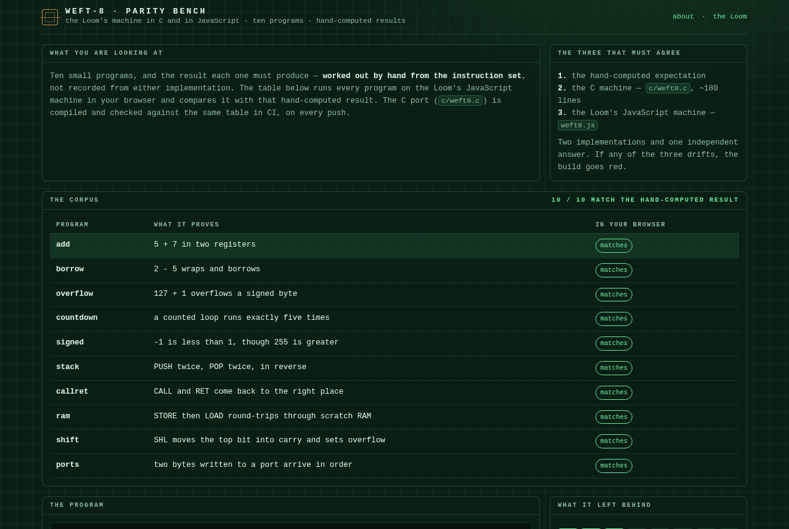

<div align="center">

# Weft-8 on hardware

**The Loom's 8-bit machine, in C — and a bench that proves it is the same machine.**

[](https://drsamonline.github.io/weft8-hardware/)
[](https://github.com/drsamonline/weft8-hardware/actions/workflows/test.yml)
[](https://github.com/drsamonline/weft8-hardware/actions/workflows/build-apps.yml)
[](LICENSE)
[-c98b4b?style=flat-square&labelColor=0b1f14)](https://github.com/drsamonline/app-jacquard)

[**Open the parity bench →**](https://drsamonline.github.io/weft8-hardware/)

</div>



A machine described in one language can hide a mistake inside that language's habits. So the Weft-8 —
the 8-bit computer from [Jacquard, the Loom](https://github.com/drsamonline/app-jacquard) — is written
here a second time, in about 180 lines of C, and the two implementations are held against an answer
neither of them produced: **ten programs whose results were worked out by hand from the instruction set**.

| | |
|---|---|
| `c/weft8.c`, `c/weft8.h` | the machine: 16 registers, Z/C/N/V, 256 bytes, 27 two-byte opcodes |
| `c/main.c` | runs the corpus, prints one JSON object per program |
| `corpus.json` | ten programs and the results they must produce — **hand-computed** |
| `tools/gen-corpus.mjs` | assembles the corpus with the Loom's own assembler into `c/corpus.h` |
| `tools/parity.mjs` | three-way comparison: hand-computed vs C vs JavaScript |
| `docs/play/` | the bench: the same corpus, run live in your browser |

## The three that must agree

1. **the hand-computed expectation** — worked out from the ISA, not recorded from either machine
2. **the C machine** — `gcc -O2`, run over the corpus in CI on every push
3. **the Loom's JavaScript machine** — `docs/play/weft8.js`, byte for byte the engine every Weft app runs

If any of the three drifts, the build goes red. That is the whole design.

## What the corpus proves

| program | claim |
|---|---|
| `add` | 5 + 7 lands in a register with no flags raised |
| `borrow` | 2 − 5 wraps to `0xFD` and sets carry and negative |
| `overflow` | 127 + 1 sets overflow — what makes signed branches correct |
| `countdown` | a counted loop runs exactly five times |
| `signed` | −1 is less than 1, though 255 is greater |
| `stack` | PUSH/POP return values in reverse order |
| `callret` | CALL and RET come back to the right place |
| `ram` | STORE then LOAD round-trips through scratch RAM |
| `shift` | SHL moves the top bit into carry |
| `ports` | two bytes written to a port arrive in order |

## Run it

```
node tools/gen-corpus.mjs              # assemble corpus.json -> c/corpus.h
gcc -O2 -o weft8-corpus c/weft8.c c/main.c
./weft8-corpus                          # ten JSON lines
node tools/parity.mjs ./weft8-corpus    # the three-way check
node test-node.js                       # 91 assertions about the corpus, the C and the page
```

On a microcontroller the same `weft8.c` is the machine, and the peripherals become real pins: a port
write can drive an LED or read a button. That step is not shipped here yet — an ESP32 sketch that has
never been compiled would be a claim, not a proof, and this repository is about proofs.

**Honest note.** This repository's own sandbox had no C compiler, so the C is compiled and checked by
CI on every push, not locally. `test-node.js` covers everything that can be checked without a compiler:
that the corpus is well-formed and unique, that the JavaScript machine reproduces every hand-computed
result, that the C source implements all 27 opcodes and carries the same guards, and that
`c/corpus.h` carries the exact bytes of every program.

## Licence

**PolyForm Noncommercial 1.0.0** · © 2026 Dr Sohil Momin. Free for any noncommercial purpose.
